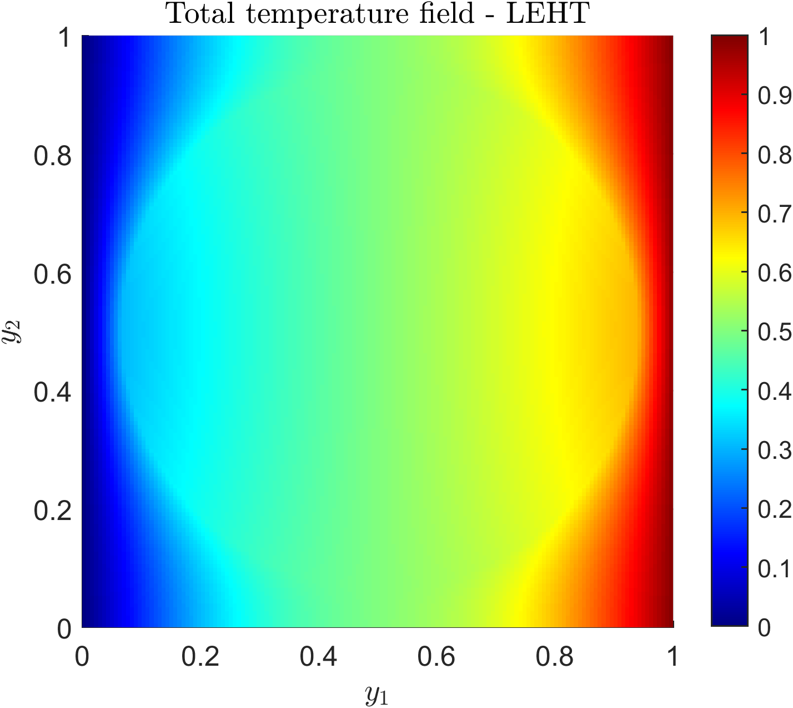
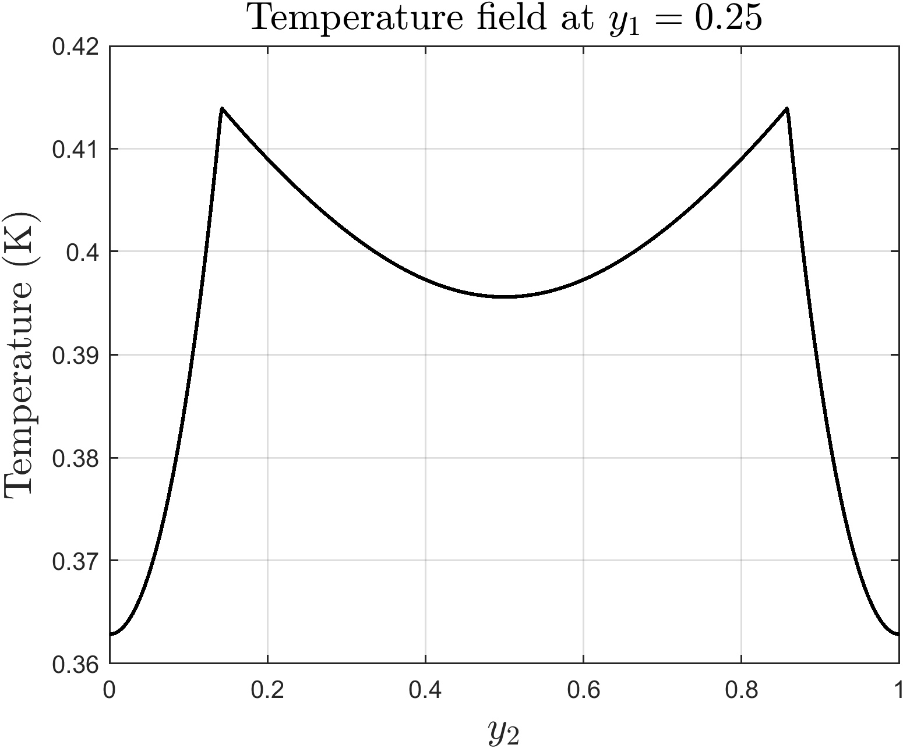
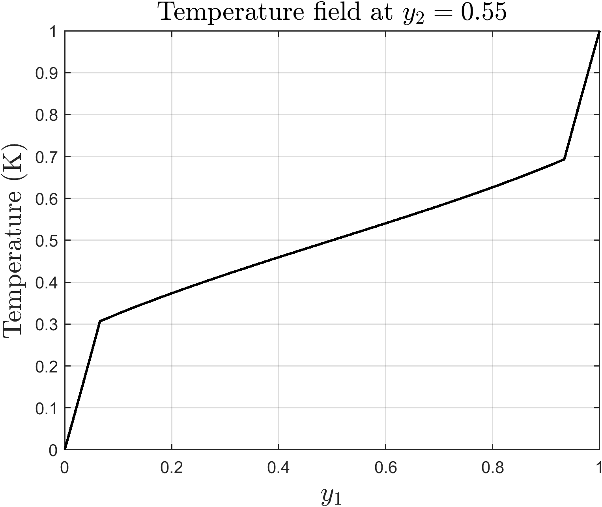

## 📐 Locally-Exact Homogenization Theory (LEHT)

The Locally-Exact Homogenization Theory (LEHT) is an analytical approach based on the Trefftz concept, in which the local fields are represented by series expansions that satisfy the governing differential equations. The solution is obtained by imposing continuity conditions at the inclusion–matrix interface and periodicity conditions on the unit cell. This methodology allows the effective thermal conductivity of materials with inclusions to be determined. The LEHT formulation implemented in this repository is based on Wang et al. (2020): [https://doi.org/10.1016/j.ijheatmasstransfer.2020.119477](https://doi.org/10.1016/j.ijheatmasstransfer.2020.119477).

In the present implementation, the series are truncated at $N = 60$ harmonics, the interface continuity conditions are satisfied exactly for each harmonic, and the periodicity conditions are enforced by least-squares collocation at 300 points per face of the unit cell. The code provides the analytical reference solution used to verify the FVDAM codes in the [FVDAM2D-THERMAL](https://github.com/digotiago04/FVDAM2D-THERMAL) repository.

### Syntax

The `LEHT_Thermal.m` function computes the effective thermal conductivity matrix, generates the 2D temperature field, and extracts 1D temperature profiles for a square repeating unit cell (RUC) with a centered circular inclusion.

```matlab
LEHT_Thermal(k_m, k_i, frac, field, y1_cut, y2_cut)
```

**Table 1:** Input parameters - LEHT

| Parameter | Description | Accepted Values |
| :---: | :--- | :---: |
| **`k_m`** | Thermal conductivity of the matrix phase. | `> 0` |
| **`k_i`** | Thermal conductivity of the inclusion phase. | `> 0` |
| **`frac`** | Volume fraction of the inclusion in the repeating unit cell (RUC). | `[0.05, 0.75]` |
| **`field`** | Enables or disables the plotting of the total 2D temperature field. | `0` (disable) or `1` (enable) |
| **`y1_cut`** | Coordinate to extract the vertical temperature profile. | `0` (disable) or `0 < y1_cut <= 1` |
| **`y2_cut`** | Coordinate to extract the horizontal temperature profile. | `0` (disable) or `0 < y2_cut <= 1` |

### Usage Example

To run the analysis with a matrix conductivity of $0.5 \ W/(m \cdot K)$, inclusion conductivity of $4.5 \ W/(m \cdot K)$, and a volume fraction of 60%, while also generating the 2D temperature field and extracting profiles at $y_1 = 0.25$ and $y_2 = 0.55$, execute the following command:

```matlab
LEHT_Thermal(0.5, 4.5, 0.6, 1, 0.25, 0.55)
```

***Command Window Output:***
```text
EFFECTIVE THERMAL CONDUCTIVITY MATRIX (K*)
    1.4715   -0.0000
   -0.0000    1.4715
```

***Graphical Results:***

The command above will also generate the following plots:

|  |  |  |
| :---: | :---:  |:---: |

---

## 💻 Requirements
The implementation of this tool was entirely developed in the MATLAB environment (version R2022b). Its development did not require the use of additional tools or packages, so the code can be executed in a standard MATLAB installation.

---

## ❌ Reporting issues

We strive to ensure that this LEHT implementation is accurate and efficient. However, if you encounter any unexpected behavior, inconsistencies, or potential bugs in the code, your feedback is highly appreciated.

Please feel free to reach out via email:
📩 diogo.santos@ctec.ufal.br

Your contributions help improve the reliability and usability of this project for the scientific community.

---

## 📚 Author
Project developed by:
* Diogo Tiago dos Santos 📩 diogo.santos@ctec.ufal.br
